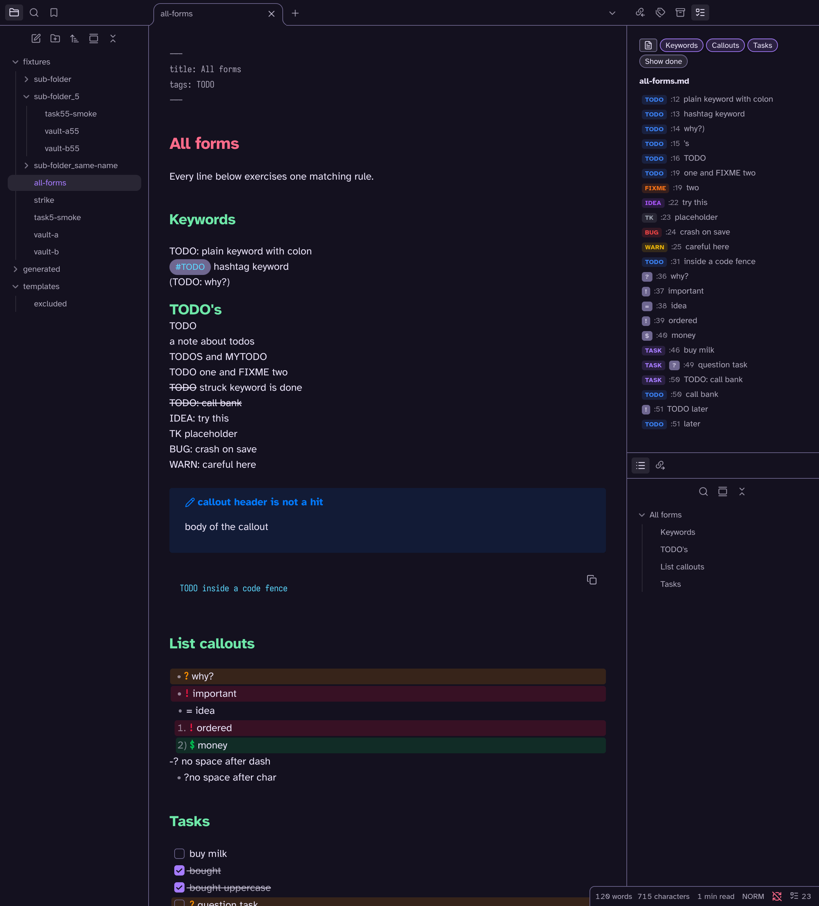

# Trouble Tags in Obsidian

A sidebar panel, inspired by [trouble.nvim](https://github.com/folke/trouble.nvim), that lists the things you want to come back to: `TODO`-style keywords, list callouts and open checkbox tasks. It shows the current note by default, or the whole vault, and jumps to the line when you click an entry. It does nothing while the panel is closed and never changes a note unless you press a check button.



## What it finds

| Source | Syntax | Example |
| --- | --- | --- |
| Keywords | Upper case keyword, with or without `#` | `TODO: call bank`, `#FIXME`, `(TODO)`, `## TODO's` |
| List callouts | List item starting with a configured character | `- ? question`, `- ! important`, `- = idea` |
| Tasks | Markdown checkbox | `- [ ] buy milk` |

- Keywords are case sensitive and need word boundaries: `todo`, `TODOS` and `MYTODO` do not match.
- Default keywords: `TODO, FIXME, BUG, NOTE, WARN, IDEA, TK`.
- Callout headers such as `> [!NOTE]` and frontmatter are skipped. Code blocks are scanned.
- A keyword inside `~~strikethrough~~` and a checked task (`[x]`) count as done and are hidden unless "Show done" is on.

## Usage

- **Open the panel:** click the ribbon icon or run "Toggle Trouble Tags panel" from the command palette.
- **Filter chips:** Keywords, Callouts and Tasks switch each source on or off. "Show done" includes finished items. The chips are remembered.
- **Scope toggle:** the first button in the panel header switches between the current note and the whole vault. The choice is remembered.
- **Whole vault:** press "Build index" once. After that the panel opens instantly and only rescans notes that changed. Results are grouped by file, newest first, and each file can be collapsed.
- **Click a row** to jump to its line. This also works when the note is in reading mode.
- **Mark done:** the check button on a row turns `TODO` into `~~TODO~~` or `[ ]` into `[x]`. On a done row (with "Show done" on) an undo button restores it, including keywords inside a wider `~~struck span~~`. Callouts have no done state. If the line changed since the last scan, a notice appears and nothing is edited.

## Settings

| Setting | Default | What it does |
| --- | --- | --- |
| Keywords | `TODO, FIXME, BUG, NOTE, WARN, IDEA, TK` | Comma separated keywords, matched in upper case. |
| Keyword match | Hashtag and bare | Also "Hashtag only" and "Bare only". |
| Callout characters | `& ? ! ~ @ $ % =` | Space separated characters. "Import from List Callouts" copies them from the List Callouts plugin. |
| Show done items | Off | Include completed tasks and struck-through keywords. |
| Status bar count | Off | Shows the number of open items of the current note in the status bar. Click it to toggle the panel. Not available on mobile. |
| Icon | List todo | Icon of the ribbon button and the panel tab. |
| Excluded folders | Empty | One folder path per line, skipped when building the vault index. |
| Rebuild index | | Discards the cached index. |
| Clear index | | Deletes the cached index. |

Changing keywords, match mode, callout characters or excluded folders discards the vault index. The panel then offers "Build index" again; it never rebuilds by itself.

## Whole-vault index

- The index is built only when you press "Build index". Opening Obsidian, opening a note or switching to the vault scope never scans the vault by itself.
- It is stored as `index.json` in the plugin folder, not in your notes. It is a disposable cache: delete it any time (or use "Clear index") and build it again.
- With an index present, switching to the vault scope compares modification times and rescans only new or changed notes.
- Notes in excluded folders are left out.

## Install

Once the plugin is published: Settings, Community plugins, Browse, search for "Trouble Tags", install and enable.

Manually: build or download `main.js`, `manifest.json` and `styles.css`, put them in `<vault>/.obsidian/plugins/trouble-tags/` (copy or symlink this folder), then enable the plugin in Settings, Community plugins.

## Development

```sh
npm install
npm run dev     # watch and rebuild main.js
npm run build   # type-check and bundle
npm test        # unit tests (node --test)
```

For manual testing, `node scripts/make-test-notes.mjs` writes fixture notes (all matching forms plus 300 generated notes) into a throwaway vault at `~/git/obsidian/trouble-tags-testvault`. It only creates or overwrites its own files.

## Credits

- Inspired by [trouble.nvim](https://github.com/folke/trouble.nvim).
- List callout characters follow the [List Callouts](https://github.com/mgmeyers/obsidian-list-callouts) plugin.

*Also check out my other plugin: [Obsidian Open Specific File](https://github.com/sspaeti/obsidian-open-specific-notes)*
